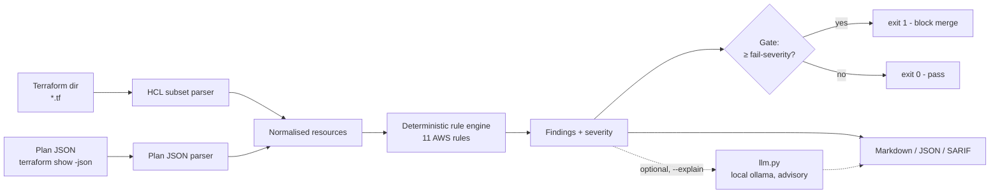

# iac-pr-guard

**Catch cloud misconfigurations in Terraform before they merge, and fail the build when they are serious.**

`iac-pr-guard` scans a Terraform directory (or a `terraform show -json` plan), runs a deterministic set of AWS security rules, and emits a PR-style review grouped by severity with remediation for each finding. It exits non-zero when anything at or above a configurable severity is found, so it drops straight into a CI pipeline as a merge gate.

## The problem

Most cloud breaches start with a boring misconfiguration: a public S3 bucket, SSH open to `0.0.0.0/0`, an IAM policy with `"Action": "*"`, an unencrypted database. These are cheap to catch in the pull request and expensive to catch in production. This tool makes "no new high-severity misconfigurations" an automatic, reviewable check on every PR.

## What it does

1) Parses Terraform. It accepts a directory of `.tf` files (hand-rolled HCL subset parser, zero dependencies) or Terraform plan JSON (`terraform show -json`), which is what real CI already produces.
2) Runs 11 deterministic rules covering common AWS misconfigurations (S3, security groups, IAM, EBS, RDS, CloudTrail). No network, no cloud account, no API key.
3) Reports findings as a markdown PR comment, JSON (for tooling), or SARIF (for GitHub code scanning). Each finding has a rule id, resource address, severity, file and line, the reason, and a remediation.
4) Gates CI. The process exits non-zero when any finding is at or above `--fail-severity` (default `HIGH`).
5) Optionally drafts a friendlier plain-language note per finding with a local LLM (`--explain`). That text is clearly labelled AI-generated and advisory. The scanner itself is pure deterministic code.

## Architecture



## Quickstart

```bash
git clone https://github.com/aminafara123/iac-pr-guard
cd iac-pr-guard
make install          # pip install -e ".[dev]"  (stdlib-only runtime)
make test             # pytest -q, fully offline
python -m iac_pr_guard --demo            # scan the bundled insecure sample
```

Scan your own code:

```bash
python -m iac_pr_guard path/to/terraform                 # a directory of .tf files
python -m iac_pr_guard plan.json --format sarif          # a terraform plan, as SARIF
python -m iac_pr_guard path/to/terraform --fail-severity MEDIUM   # stricter gate
```

### Install as a CLI

```bash
pipx install git+https://github.com/aminafara123/iac-pr-guard
iac-pr-guard --demo            # scan the bundled insecure sample
iac-pr-guard ./infra           # scan your Terraform
```

## Sample run

Input: the bundled insecure stack (`iac_pr_guard/samples/bad-stack`).

```
$ iac-pr-guard --demo
# IAC PR Guard - security review

> Automated Terraform scan from a deterministic rule engine. Not a compliance attestation; a human must review before merge.

**Gate:** FAIL (fail-severity = HIGH)  |  **Findings:** 11

| Severity | Count |
|---|---|
| HIGH | 4 |
| MEDIUM | 5 |
| LOW | 2 |
| **Total** | **11** |

## HIGH (4)

### `S3_PUBLIC_ACL` - `aws_s3_bucket.data`
- Location: `iac_pr_guard/samples/bad-stack/main.tf:8`
- Why: S3 bucket ACL is "public-read".
- Remediation: Set acl = "private" and add an aws_s3_bucket_public_access_block with all four flags = true.
...
$ echo $?
1
```

The hardened stack (`iac-pr-guard --demo clean`) reports zero findings and exits `0`.

### In CI (GitHub Actions)

```yaml
- run: pipx install git+https://github.com/aminafara123/iac-pr-guard
- run: iac-pr-guard ./infra --fail-severity HIGH    # non-zero exit blocks the merge
```

## How it works

Both inputs normalise to the same resource objects, so one rule engine serves `.tf` and plan JSON alike. Each rule is a small pure function mapped to a rule id, a severity, and a remediation (see `iac_pr_guard/rules.py`). Findings are sorted by severity, rendered by `report.py`, and the CLI turns "a finding at or above the fail severity exists" into the process exit code. The LLM path in `llm.py` is optional and isolated: if the endpoint is unreachable it returns nothing and the deterministic report is unaffected.

### Rules covered

S3 public ACL, S3 no encryption, S3 no versioning, security group open ingress to sensitive ports (22/3389/3306/5432/...), overly open egress, IAM wildcard action, IAM wildcard resource, unencrypted EBS, unencrypted RDS, publicly accessible RDS, and missing CloudTrail.

### Known limits

The rule set is representative, not exhaustive (it is a PR triage aid, not a replacement for Checkov or tfsec). The bundled HCL parser handles a focused subset: resource and nested blocks, scalar attributes, single-line lists, and heredocs. It does not resolve variables or modules, `jsonencode(...)`, single-line blocks, or multi-line lists. For full fidelity, feed it plan JSON instead. These ceilings are marked with `ponytail:` comments in the source.

## Honesty and safety

- Findings come from deterministic code. The `--explain` notes are AI-generated, advisory, and labelled as such in the output. A human must review before merge.
- This tool does not claim compliance or certainty. It is a drafting and triage aid.
- The bundled samples contain no real credentials or client data. The insecure stack is intentionally broken for demonstration and must not be deployed.

## Demo


## Tech stack

Python 3.9+ standard library only at runtime (no third-party dependencies). `pytest` for the offline test suite. Packaged with `hatchling`, installable via `pipx`. Optional local LLM through an OpenAI-compatible endpoint (ollama by default).

## License

MIT, (c) 2026 Al Amin Bashir Afara. See [LICENSE](LICENSE).
